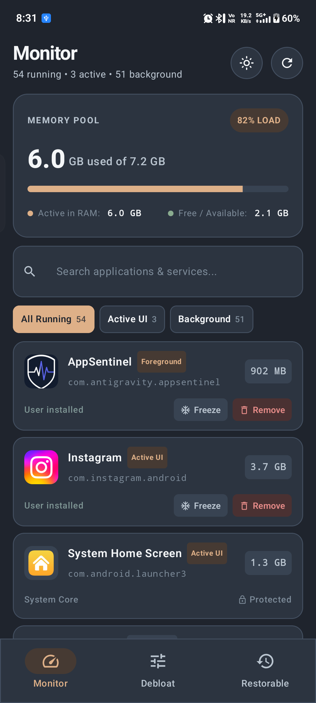
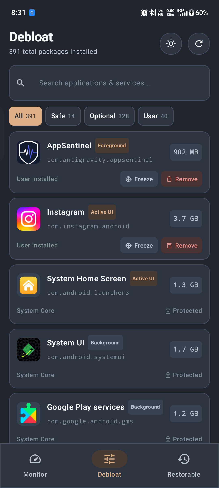
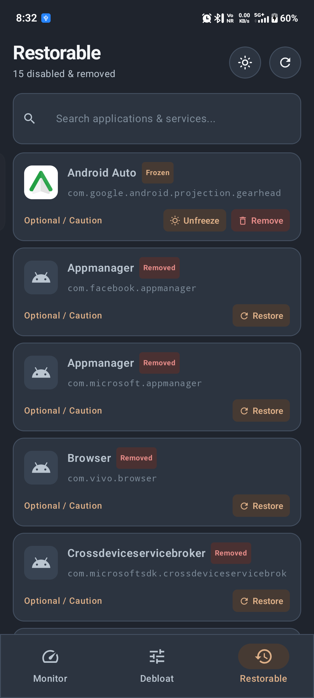

# AppSentinel 🛡️

**AppSentinel** is a modern, privacy-focused Android system monitor and debloating utility engineered with Jetpack Compose, Material 3, and the Shizuku API. It provides real-time hardware telemetry and non-root system debloating with zero risk of bricking your device.

---

## 📱 Screenshots

<p align="center">
  
  
  
</p>

---

## ✨ Features

* **⚡ Real-Time Hardware Telemetry:** Live RAM consumption tracking, capacity monitoring, and running process state analysis (`dumpsys meminfo`).
* **🧹 Safe Non-Root Debloating:** Safely uninstall bloatware and background tracking services at the user profile level (`pm uninstall -k --user 0`) via Shizuku.
* **❄️ Application Freezing:** Freeze (`pm disable-user`) and unfreeze background packages on demand to reclaim memory without removing packages.
* **🔄 Instant One-Click Restoration:** Dedicated **Restorable** tab to instantly bring back removed or disabled system apps (`pm install-existing --user 0`).
* **🧠 Curated Safety Knowledge Base:** Built-in intelligence categorization (`Safe Debloat`, `Caution / Optional`, `User App`, `System Core (Protected)`).
* **🎨 Modern Material 3 Design:** Carefully tuned theme palette ("Twinkle" Twilight Charcoal & Warm Caramel Sand) with smooth interactions and responsive typography.

---

## 🏗️ Architecture

```
com.antigravity.appsentinel
├── data
│   ├── CuratedKnowledgeBase.kt   # Package safety ratings & descriptions
│   ├── ShizukuManager.kt          # Shizuku binder lifecycle & privileged shell execution
│   └── SystemMonitorRepository.kt # System memory telemetry & package inspection
├── model
│   └── AppInfo.kt                 # Domain models (AppInfo, SafetyLevel, SystemHealth)
├── ui
│   ├── components
│   │   ├── AppIcon.kt             # Asynchronous LRU-cached application icon loader
│   │   ├── AppItemCard.kt         # Package detail card with freeze/restore/remove actions
│   │   └── SystemHealthCard.kt    # Live memory telemetry card
│   ├── screens
│   │   └── MainScreen.kt          # Primary dashboard (Monitor, Debloat, Restorable tabs)
│   └── theme
│       ├── Color.kt               # Production color design tokens
│       └── Theme.kt               # Dynamic Material 3 theme provider
└── viewmodel
    └── MainViewModel.kt           # State management & reactive coroutine pipelines
```

---

## 📋 Prerequisites

1. Android 8.0 (Oreo / API 26) or higher.
2. [Shizuku](https://shizuku.rikka.app/) installed and running on your Android device (via Wireless Debugging, ADB, or Root).
3. Grant AppSentinel permission when prompted by Shizuku.

---

## 🛠️ Build and Installation

### Prerequisites
* JDK 17
* Android SDK (API 34)

### Clone & Build
```bash
# Clone the repository
git clone https://github.com/MonuChaudhary14/App-Sentinel.git
cd App-Sentinel

# Build debug APK
./gradlew assembleDebug

# Install on a connected ADB device
./gradlew installDebug
```

---

## 🔒 Safety & Reversibility

AppSentinel operates strictly via user-level package management (`--user 0`):
* System core APKs remain intact in the system partition.
* Removed applications can be restored at any time directly within the app's **Restorable** tab or via ADB:
  ```bash
  adb shell pm install-existing --user 0 <package.name>
  ```

